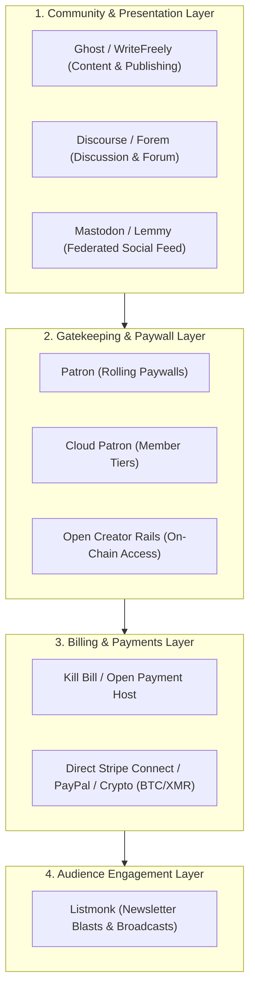

  

  
  
  
  
  
  

# 🚀 Awesome Subscription-Based Social Media Platforms & Creator Monetization

> A comprehensive, SEO-optimized, and community-curated directory of **SaaS products**, **membership portals**, and **open-source GitHub projects** powering the next generation of the **creator economy**, **paywalled social media**, and **direct fan subscriptions**.

---

## 📌 Table of Contents
- [🌐 Sector Overview & Market Dynamics](#-sector-overview--market-dynamics)
- [💳 SaaS & Hosted Platforms](#-saas--hosted-platforms)
- [⚡ Open-Source GitHub Projects](#-open-source-github-projects)
- [🏗️ Self-Hosted Architecture & Custom Stacks](#️-self-hosted-architecture--custom-stacks)
- [❓ Frequently Asked Questions (FAQ)](#-frequently-asked-questions-faq)
- [🤝 How to Contribute](#-how-to-contribute)
- [⭐ Star History](#-star-history)
- [💖 Support & Sponsorship](#-support--sponsorship)
- [⚖️ Disclaimer & Compliance](#️-disclaimer--compliance)

---

## 🌐 Sector Overview & Market Dynamics

The global **Creator Economy & Subscription-Based Social Media** sector is estimated at **$250 Billion in 2024–2026** and projected to surge past **$520 Billion by 2030** at an annual growth rate (CAGR) of over **22.5%**. 

The market dynamics exhibit a **barbell structure (moderately concentrated at the top with a massive, fragmented long tail)**:
- **Winner-Take-Most Core**: Mega-hubs like OnlyFans and Patreon capture the majority of aggregate gross transaction volume due to high two-sided network effects, established audience trust, and resilient global payment processing rails.
- **Fragmented Vertical Long Tail**: As creators push back against steep **10%–20% platform take-rates** and platform de-platforming risks, market share is rapidly decentralizing toward niche vertical SaaS (Ghost, Substack, Kajabi, Circle, Skool) and sovereign, **self-hosted open-source software** (Ghost, Discourse, Listmonk, Patron, Mirlo) offering zero platform fees and direct payment ownership.

---

## 💳 SaaS & Hosted Platforms

Below is a curated comparison of leading hosted subscription social media and creator monetization platforms, **sorted descending by company size (valuation / annual revenue)**.

| 🏢 Platform | 📈 Company Size (Valuation / Revenue) | 🏷️ Starting Pricing & Commission | 🎁 Free Tier / Trial Limits | 🎯 Key Focus & Target Audience |
| :--- | :--- | :--- | :--- | :--- |
| **[OnlyFans](https://onlyfans.com/)** | **~$5.5B – $8.0B** est. valuation ($6.6B gross revenue, $1.3B net revenue) | **20% platform cut** on all creator earnings; creators set subscriptions from **$4.99/mo to $49.99/mo**; PPV messages $3–$100 | **Free-forever creator profile** (set monthly sub to $0/free for all followers; 20% cut applies only when PPV media is purchased or tips sent) | Adult creators, premium fan-to-creator interaction, pay-per-view chat, and direct tipping |
| **[Patreon](https://www.patreon.com/)** | **~$4.0B** valuation ($150M – $200M annual revenue) | **8%** (Pro) or **10%** (New creators) platform fee + payment processing (**2.9% + $0.30** per payment >$3; 5% + $0.10 for microtransactions) | **Free-forever plan with 0% platform fee** for free members (publish free posts, polls, audio, and community updates to unlimited free members with no time limit) | Podcasters, YouTubers, visual artists, writers, and community builders with tiered rewards |
| **[Kajabi](https://kajabi.com/)** | **~$2.0B** valuation ($150M+ ARR) | Starts at **$69/month** (Kickstarter plan, billed annually; or $89/mo monthly) for 1 product & 1 funnel; **$149/month** (Basic plan, billed annually) for 3 products. **0% transaction fees** | **14-day free trial** with full platform access to configure 1 product, 1 funnel, up to 250 contacts, and 50 active customers; no permanent free plan | Knowledge commerce, comprehensive online courses, private coaching circles, and gated video libraries |
| **[Locals](https://locals.com/)** | **~$1.5B – $2.0B** parent market cap (Rumble Inc. NASDAQ: RUM; $25M+ division ARR) | **10% platform revenue share** + standard credit card processing (**~2.9% + $0.30**); minimum subscription price is **$2/mo** | **Free-forever community hosting** (free members can join communities, read free public posts, view trailers, and participate in open feeds with zero fees) | Political commentators, independent journalists, video creators, and uncensored discussion communities |
| **[Substack](https://substack.com/)** | **~$650M** valuation ($35M+ ARR) | **$0/mo base fee + 10% cut** of paid subscription revenue, plus Stripe fees (**2.9% + $0.30**); minimum subscription is **$5/mo or $50/yr** | **100% Free forever with 0% platform fee** for free newsletters; unlimited free email subscribers, unlimited post sends, podcast feeds, and community chat | Independent journalists, essayists, newsletter publishers, serialized authors, and podcast hosts |
| **[Circle.so](https://circle.so/)** | **~$250M** valuation ($30M+ raised, $20M+ ARR) | Starts at **$89/month** (Basic plan, billed annually; or $99/mo monthly) + **4% transaction fee**; Business plan at **$199/month** + **2% fee** | **14-day free trial** with full access to test community spaces, course modules, live streams, and paid access tiers (up to 1,000 members during trial) | Creators, brand communities, cohort-based courses, masterminds, and private member networks |
| **[Fansly](https://fansly.com/)** | **~$150M – $200M** est. valuation (~$150M+ gross volume) | **20% platform commission** across all subscription tiers, tips, and paywalled media sales; payouts via ACH, Paxum, or crypto | **Free-forever creator account** with multi-tier permissions (creators can maintain a $0/mo free follower tier with public preview posts before paywalling) | Adult & glamour creators, customizable tiered paywalls, and internal recommendation discovery |
| **[Skool](https://skool.com/)** | **~$100M+** valuation ($30M+ ARR) | Flat **$99/month per group** (**0% platform transaction fee**; standard Stripe processing 2.9% + $0.30) | **14-day free trial per group** with unlimited members, gamified level systems, community discussion boards, and classroom hosting | Gamified creator communities, cohort academies, group coaching, and student engagement challenges |
| **[Fourthwall](https://fourthwall.com/)** | **~$100M** valuation ($17M+ raised) | **$0/mo base fee**; **0% fee on physical merch** (margin-based); **5% fee on digital products & memberships** + processing (**2.9% + $0.30**) | **Free-forever plan** with full access to store builder, membership gating, custom domain, YouTube Shopping integration, and zero monthly software fees | Creators combining physical merchandise, print-on-demand goods, digital downloads, and supporter memberships |
| **[Memberful](https://memberful.com/)** | **~$50M+** division value (Acquired by Patreon) | Starts at **$0/month + 10% transaction fee** (Starter plan); Pro plan at **$25/month + 4.9% transaction fee** + Stripe fees (**2.9% + $0.30**) | **Free-forever Starter plan** with unlimited members, 2 active subscription plans, WordPress plugin integration, and Discord bot syncing | Website owners, publishers, and developers wanting white-label membership billing on WordPress/custom sites |
| **[Fanvue](https://fanvue.com/)** | **~$40M – $50M** valuation (~$10M+ GMV) | **15% platform commission** for first 3 months (promotional), then **20% commission thereafter** on fan subscriptions and paid messaging | **Free-forever creator account** supporting free follower tiers, teaser posts, broadcasts, and direct messaging previews with no upfront cost | AI creators, virtual influencers, digital personas, and automated paywalled fan chat |
| **[Buy Me a Coffee](https://www.buymeacoffee.com/)** | **~$25M – $50M** est. valuation ($100M+ creator payouts) | **5% flat platform fee** on one-time support donations, recurring memberships, and shop sales + standard Stripe/PayPal fees (**~2.9% + $0.30**) | **100% Free forever** with zero monthly fees, unlimited supporters, unlimited creator updates, and zero charges until transactions occur | Minimalist tipping, micro-memberships, quick exclusive posts, and lightweight community support |

---

## ⚡ Open-Source GitHub Projects

Explore the premier self-hostable creator monetization platforms, paid membership software, and decentralized social networks. **Sorted descending by GitHub Stars_Count**.

| 📦 Repository & Stars | 🛠️ Tech Stack & Architecture | 💡 Creator Monetization Capabilities | 📜 License |
| :--- | :--- | :--- | :--- |
| **[Ghost](https://github.com/TryGhost/Ghost)**  | Node.js, Ember.js, MySQL | Independent publishing platform with native paid memberships, tiered subscription paywalls, automated email newsletters, and 0% platform fees via direct Stripe Connect. | MIT |
| **[Mastodon](https://github.com/mastodon/mastodon)**  | Ruby on Rails, React, ActivityPub | Decentralized, federated microblogging social network. Instance owners and creators can integrate supporter badges, Patreon/OpenCollective webhooks, and private member servers. | AGPL-3.0 |
| **[Discourse](https://github.com/discourse/discourse)**  | Ruby on Rails, Ember.js, PostgreSQL | Modern community discussion platform. Features official `discourse-subscriptions` plugin for recurring paid memberships, private tier categories, and exclusive patron lounges. | GPL-2.0 |
| **[ERPNext](https://github.com/frappe/erpnext)**  | Python, Frappe Framework, MariaDB | Full-featured business operating system with dedicated Subscription Billing, automated recurring invoicing, CRM, and customer portal for enterprise-scale creator businesses. | GPL-3.0 |
| **[Listmonk](https://github.com/knadh/listmonk)**  | Go, Vue.js, PostgreSQL | High-performance, self-hosted newsletter and mailing list manager. Perfect for sending high-throughput paid subscriber blasts, broadcasts, and marketing campaigns with minimal RAM. | AGPL-3.0 |
| **[Forem](https://github.com/forem/forem)**  | Ruby on Rails, Preact, PostgreSQL | Open-source software powering DEV.to. Enables creators and niche networks to spin up collaborative blogging, user profiles, discussion feeds, and community sponsorship modules. | AGPL-3.0 |
| **[NodeBB](https://github.com/NodeBB/NodeBB)**  | Node.js, WebSockets, MongoDB / Redis | Real-time forum and community software with rich plugin ecosystem. Supports paid user groups, subscription gating, and Stripe integration for private discussions. | GPL-3.0 |
| **[Lemmy](https://github.com/LemmyNet/lemmy)**  | Rust, Actix-web, PostgreSQL | Federated link aggregator and social forum alternative to Reddit. Communities can self-host federated spaces and fund hosting via member sponsorships. | AGPL-3.0 |
| **[Kill Bill](https://github.com/killbill/killbill)**  | Java, OSGi, MySQL / PostgreSQL | Open-source subscription billing and payments architecture. Powers custom recurring billing plans, coupon systems, multi-currency invoices, and complex creator payout tiers. | Apache-2.0 |
| **[WriteFreely](https://github.com/writefreely/writefreely)**  | Go, SQLite / MySQL, ActivityPub | Minimalist, distraction-free federated blogging platform. Supports reader subscriptions, multi-author blogs, and ActivityPub federation so readers can follow from Mastodon. | AGPL-3.0 |
| **[CiviCRM](https://github.com/civicrm/civicrm-core)**  | PHP, MySQL, CMS integrations | Open-source constituent relationship management system tailored for nonprofits, clubs, and creators needing recurring membership dues, tax receipts, and member directories. | AGPL-3.0 |
| **[Markdown Ninja](https://github.com/skerkour/markdown-ninja)**  | Rust, Markdown | Markdown-first CMS for bloggers and startups. Open-source alternative to Substack and Medium that lets writers publish websites and newsletters directly from Markdown files. | AGPL-3.0 |
| **[Cloud Patron](https://github.com/cloudpatron/cloudpatron)**  | Node.js, Vue.js, Express | Self-hosted Patreon alternative providing creator subscription funding, tiered memberships, and paywalled multimedia content gating without recurring software fees. | AGPL-3.0 |
| **[Mirlo](https://github.com/funmusicplace/mirlo)**  | Node.js, Express, Svelte | Open-source audio distribution and patronage platform built specifically for musicians, audio storytellers, and podcasters to receive direct monthly listener support. | AGPL-3.0 |
| **[Open Payment Host](https://github.com/abishekmuthian/open-payment-host)**  | Go, Docker | Self-hosted payment and subscription gateway hub supporting Stripe, Square, PayPal, and Razorpay. Lets creators sell digital subscriptions with zero intermediary commissions. | AGPL-3.0 |
| **[Patron](https://github.com/patroninc/patron)**  | Rust, React, TypeScript | Open-source Patreon alternative with 1% lifetime fees designed for serial creators (webcomics, serialized books, podcasts) with rolling paywalls that unlock content on schedules. | AGPL-3.0 |
| **[Fountain](https://github.com/fountain-ink/app)**  | TypeScript, Lens Protocol, Grove | Decentralized Web3 publishing platform alternative to Substack, Medium, and Mirror, leveraging Lens Protocol for sovereign social graphs and decentralized storage. | AGPL-3.0 |
| **[Open Creator Rails](https://github.com/ChainSafe/open-creator-rails)**  | Solidity, TypeScript, Ethereum | Open-source blockchain paywall and recurring subscription primitive developed for Ethereum Foundation to enable direct on-chain gated content without platform custody. | Apache-2.0 |
| **[Createon](https://github.com/opd-ai/createon)**  | Go, Flat-file | Self-hosted Patreon alternative enabling creators to monetize content using cryptocurrency payments (Bitcoin & Monero) with no database required and automated payment checks. | GPL-3.0 |

---

## 🏗️ Self-Hosted Architecture & Custom Stacks

When architecting a self-hosted creator monetization ecosystem, combine modular open-source layers to achieve complete data sovereignty and zero platform fees:

---

## ❓ Frequently Asked Questions (FAQ)

### What is a subscription-based social media platform?
A subscription-based social media platform is a content and community network where creators monetize directly from their audience via recurring monthly or annual membership dues, pay-per-view posts, and tipping, rather than relying on advertising algorithms or sponsor interruptions.

### What are the main benefits of self-hosting over SaaS platforms?
- **Zero Platform Take-Rates**: Avoid 10%–20% cuts charged by platforms like OnlyFans, Patreon, and Substack.
- **Audience & Data Sovereignty**: Full ownership of email lists, subscriber metrics, and customer payment tokens without fear of account de-platforming.
- **Custom Monetization Models**: Freedom to implement rolling paywalls, crypto payments, custom tiers, or hybrid digital merchandise.

### What are the best open-source alternatives to Patreon?
- **[Ghost](https://github.com/TryGhost/Ghost)**: Best for newsletters, written journalism, and tiered membership sites.
- **[Cloud Patron](https://github.com/cloudpatron/cloudpatron)**: Direct self-hosted Patreon alternative.
- **[Patron](https://github.com/patroninc/patron)**: Tailored for sequential content creators like comic artists and novelists with rolling paywalls.
- **[Discourse](https://github.com/discourse/discourse)**: Best for community discussions and paid membership forums.

---

## 🤝 How to Contribute

Contributions are warmly welcomed! Help expand and maintain this curated resource:

1. 🍴 **Fork** the repository: `https://github.com/ishandutta2007/Awesome-Subscription-Based-Social-Media-Platform`
2. 🌿 **Create a branch**: `git checkout -b feature/add-new-creator-platform`
3. 📝 **Add your project**: Follow existing table and formatting standards with verified metrics.
4. 🚀 **Submit a Pull Request**: Provide a brief summary of the project and why it belongs in the list.

---

## ⭐ Star History

---

## 💖 Support & Sponsorship

If you find this curated directory useful for your research, creator platform, or development workflow:

- ⭐ **Star this repository** to help other creators and engineers discover it!
- 🍴 **Fork and share** it across Twitter/X, LinkedIn, Discord, and Reddit.
- ☕ **Buy me a coffee & sponsor my open-source work**: Support directly via the **[GitHub Sponsors Dashboard](https://github.com/sponsors/ishandutta2007)**. Every sponsorship helps maintain and regularly update these developer resources!

  

---

## ⚖️ Disclaimer & Compliance

- This repository is a **community-curated index** provided for informational and educational purposes only.
- Operators of subscription and membership platforms must ensure full compliance with **PCI-DSS standards**, data privacy regulations (**GDPR**, **CCPA**), and local payment processor terms of service.
- Self-hosted payment systems require regular security patching, SSL/TLS configuration, and proper webhook signature verification.

---

  <b>Built with ❤️ for creators, developers, community founders, and independent publishers worldwide.</b>

